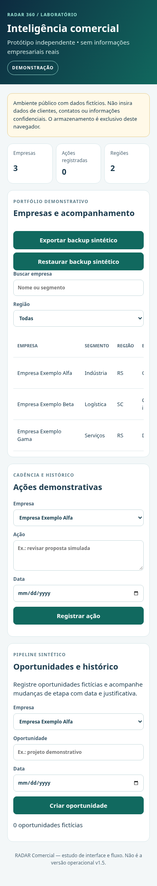
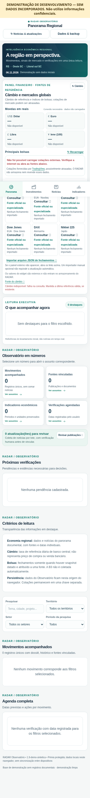
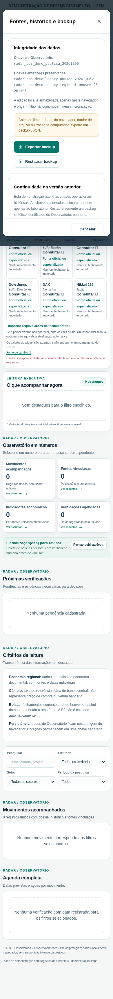

# RADAR 360 — auditoria técnica e candidata de demonstração

Data: 06/11/2026, America/Sao_Paulo (execução cruza 07/11 em UTC).
Base recuperada: `codex/desenvolvimento`, `e52cb3179dd3fd6f33d17ee6eff1c3f9c0d4dfff`.
Correções: `586261f`, branch `codex/auditoria-homologacao`.
Escopo: código público e fixtures sintéticas. Nenhuma base externa, arquivo corporativo, fonte histórica privada ou produção foi acessada.

## Parecer

Candidata para revisão técnica das **demonstrações**, com correções e testes locais; homologação Android permanece pendente. Não é recuperação do Comercial v1.5, APK, PWA, autenticação ou produto multiusuário. Não houve merge, deploy nem conexão à Vercel.

## Arquitetura e inventário

O inventário completo dos arquivos versionados na base, com bytes e SHA-256, está em [inventario.json](evidencias/auditoria-20261106/inventario.json). Não inclui dependências geradas nem arquivos externos ao repositório.

| Área | Arquivos | Responsabilidade |
| --- | --- | --- |
| Comercial | `demo/comercial.html`, `.css`, `comercial-core.js`, `comercial-ui.js` | Modelo puro com validação e cópias; DOM com `textContent`; três empresas fictícias; ações e histórico de oportunidades; sem rede |
| Observatório | `demo/observatorio.html` | HTML monolítico: seed vazio, motor de triagem, módulo financeiro, persistência, migração explícita, renderização e edição |
| API | `api/noticias.js` | Handler GET e coletor de três feeds fixos HTTPS, timeout, restrição de redirects, classificação e deduplicação |
| Empacotamento | `scripts/build-android.cjs` | Dois HTMLs, manifesto SHA-256 e instruções; incorpora CSS/JS Comercial com CSP por hash |
| Validação | `tests/`, `browser-tests/`, `playwright.config.cjs` | Node, integração Chromium, restauração, isolamento de chaves, mobile e pacote |
| Automação | `.github/workflows/` | Testes e ZIP como artefato; sem publicação de aplicativo |
| Governança | `AGENTS.md`, `docs/`, `README.md`, `.gitignore`, manifests npm | Restrições, proveniência e reprodução |

Nenhuma fonte canônica do Comercial v1.5 foi identificada no checkout ou histórico inspecionado. As referências antigas à biblioteca são declarações históricas da documentação, não verificação atual dos arquivos privados. Não reconstruir a v1.5 a partir da demo.

## Diagnóstico priorizado

| Nível | Achado e efeito | Estado / decisão |
| --- | --- | --- |
| P0 | Sem autenticação/autorização ou isolamento entre pessoas/organizações. Chaves diferentes separam módulos, mas não usuários na mesma origem. | Restrição arquitetural; somente laboratório sintético. Bloqueia uso operacional com dados reais. |
| P0 | Persistência, downloads, teclado, reabertura e restauração no Android físico não comprovados. | Bloqueia homologação física. Executar C01–C09 e O01–O04 do roteiro existente. |
| P0 | Fonte canônica Comercial v1.5 ausente. | Bloqueia recuperação/declaração de equivalência; demo preservada. |
| P1 | Datas comerciais impossíveis passavam na regex (`2026-02-30`, `2026-13-01`). | Corrigido por validação de calendário e regressão Node, incluindo ano bissexto e imutabilidade. |
| P1 | Aba desatualizada podia gravar sua cópia inteira sobre atualização de outra aba. | Escritas verificam o conteúdo observado antes de salvar/restaurar; conflito pede recarga. Testes em duas páginas nos dois módulos. Não equivale a transação atômica entre processos nem sincronização distribuída. |
| P1 | Indicador importado aceitava URL não HTTPS e campos com tipos incompatíveis com a UI. | Rejeição antes de persistir; teste confirma preservação dos bytes anteriores. |
| P1 | Botão Câmbio não era reabilitado ao terminar consulta. | `finally` libera o controle; teste reproduz falha de rede e segunda tentativa. |
| P1 | ZIP podia ser disponibilizado pelo job de empacotamento sem aguardar os testes do próprio pacote. | Job passa a exigir Node e testes dos HTMLs antes do upload. Execução remota nova ainda não confirmada. |
| P1 | Observatório carrega script TradingView no documento principal e consulta Frankfurter; o iframe posterior não isola a execução inicial do script. | Mantido para preservar funcionalidade. Revisar fornecedor, licença e política de conteúdo antes de qualquer disponibilização operacional. Capturas/axe bloquearam rede externa. |
| P1 | Cache financeiro usa outra chave, fica fora do backup regional e falhas de gravação não são confirmadas ao usuário; validação estrutural de históricos do Observatório permanece parcial. | Limite remanescente; não declarar recuperação financeira nem auditoria completa de migração 1.6/1.7. |
| P2 | Baixo contraste nos dois módulos, código longo transbordando no backup e espaço vazio do widget indisponível. | Cores secundárias ajustadas; quebra de linha; widget recolhe área vazia com fallback preservado; axe e teste de overflow do diálogo. |
| P2 | Manifesto local dizia `local-sem-commit-ci` e branch fixa; instalação sem lockfile. | Manifesto usa HEAD/branch reais, sinaliza alterações rastreadas e rejeita GITHUB_SHA divergente; lockfile e `npm ci`. |
| P2 | Diálogo sem nome acessível e texto de migração ambíguo. | Nome por `aria-labelledby`, inputs de arquivo rotulados e descrição das chaves de laboratório corrigida. |

## Testes e limites da evidência

Ambiente: Linux, Node v24.22.1, npm 11.9.0, Playwright 1.56.1; Chromium instalado 156.0.8078.79. CI declara Node 22 e navegador Playwright 141. Não são ambientes equivalentes.

| Verificação | Resultado observado |
| --- | --- |
| Base, Node | 22 aprovados antes das correções |
| Candidata, `npm ci` e `npm run check` | instalação limpa e 24 testes Node aprovados, zero falhas/skip |
| Suíte Chromium completa | 55 aprovados; 2 falharam exclusivamente na navegação `file://` por `ERR_BLOCKED_BY_ADMINISTRATOR`; exit status 1 preservado |
| Backup/restauração, três repetições, um worker, zero retries | 18 aprovados após proteção de abas; sem falha nessa execução |
| Axe e regressões após fixar axe 4.10.2 (compatível com o Node >=20 do projeto) | 6 aprovados; zero violações axe nos dois estados móveis examinados |
| HTMLs empacotados via HTTP | Dois testes aprovados, incluindo busca Comercial e diálogo Observatório; não comprovam `file://` |
| ZIP reconstruído localmente | Quatro entradas conferidas por `unzip -t`; manifesto confere SHA-256 e bytes dos dois HTMLs |
| YAML e sintaxe | YAML dos dois workflows e sintaxe dos módulos alterados verificadas; não substitui executar Actions |
| Triagem básica de segredos | Nenhuma correspondência a padrões de chave privada/AWS/GitHub nos fontes inspecionados; não é certificação de ausência de segredos |

Logs em [evidencias/auditoria-20261106](evidencias/auditoria-20261106/). Os logs textuais removem apenas ANSI e ruído do servidor HTTP; resultados e falhas permanecem. Tentativas iniciais de instalação/cache e configuração do servidor foram corrigidas. Uma repetição iniciada junto de outra suíte perdeu o servidor compartilhado (`ERR_CONNECTION_REFUSED`); a execução sequencial acima passou. Não foi classificada como falha do aplicativo.

A regressão final usa axe 4.10.2. A suíte completa anterior usou axe 4.14.0; os estados afetados foram repetidos após o ajuste de compatibilidade. Não somar essas execuções como uma única suíte.

## Auditoria móvel por capturas atuais

Chromium emulado, 390×844, dados sintéticos, rede externa abortada. Capturas inspecionadas; barra fixa aparece na posição da viewport em screenshot de página inteira. A suíte também exercita larguras 320, 390, 430, 768 e 1440 px. Sem leitor de tela, teclado Android ou dispositivo físico.

1. **Comercial — funcional com limitação de descoberta:** busca, backups e formulários legíveis; a tabela tem rolagem horizontal interna e ações à direita exigem deslocamento. Não há overflow global nos ensaios existentes.

2. **Observatório — fallback funcional:** indisponibilidade externa indicada, fontes alternativas mantidas e botão Câmbio novamente utilizável. Rótulos pequenos de 10–11 px ainda merecem teste humano de legibilidade e zoom; ausência de erros axe não comprova conformidade integral.

3. **Dados & backup — operacional:** diálogo nomeado, botões acessíveis, chave longa contida, explicação de armazenamento local. Persistência e restauração são testadas separadamente pela suíte, não inferidas da imagem.

## GitHub, pacote e próxima etapa

`git ls-remote origin refs/heads/codex/desenvolvimento` confirmou a base acima. A `main` remota continuava em `fc686d9ff437292a3d31960b27e9be5563ecf20d` durante a inspeção; não foi modificada.

A API `api.github.com` foi bloqueada pela política de rede (CONNECT 403/Forbidden). Portanto não foram recuperados status atuais, logs nem ZIP remoto do Actions. Os links antigos em `HOMOLOGACAO_ANDROID.md` permanecem referências históricas, sem revalidação nesta auditoria. O ZIP reconstruído localmente é evidência local, não o artefato baixado do pipeline.

O rascunho do ambiente recebeu apenas os domínios `api.github.com`, `cdn.playwright.dev` e `playwright.download.prss.microsoft.com`; salvar o rascunho não aplicou nem publicou a mudança. Revisar/salvar nas configurações e publicar **o ambiente de desenvolvimento** permite retomar essas verificações, sem publicar o aplicativo.

Revisar o diff contra `codex/desenvolvimento`; executar os dois workflows nessa revisão; baixar o artefato daquele commit e conferir manifesto/hashes. Só então executar o roteiro Android com dados sintéticos, registrar dispositivo/Android/Chrome e cada cenário. `file://` serve para avaliação limitada; aceite web de persistência exige origem HTTPS de teste separada, cuja publicação não está autorizada nesta tarefa. Não aprovar uso com dados reais ou equivalência à v1.5.
